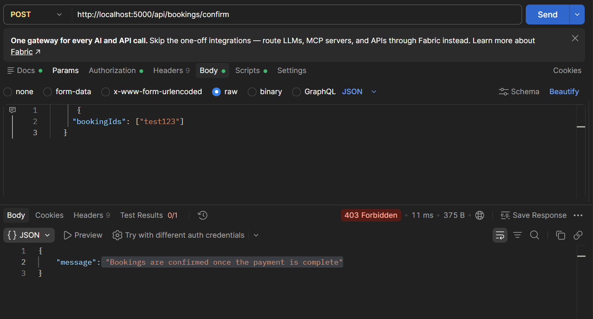

# Testing SeatLanka

I tested SeatLanka by hand to practise QA. I planned the work in **Jira**, wrote test cases from the acceptance criteria of each story, ran them and logged the bugs I found.

## How I tested

- **Manual testing** in Chrome
- **Two browsers at the same time** (normal + incognito) to act as two different passengers
- **Postman** to call the API directly
- **Jira** (Kanban board) to track stories, test tasks and bugs

My board columns: `To Do → In Progress → In Review → Testing → Done`

## How the work is set up in Jira

| Type | What it is | Example |
|---|---|---|
| Story | A feature from the passenger's side, with acceptance criteria | KAN-5 Selected seat is held for 5 minutes during payment |
| Task | Testing work, with the test cases written inside | KAN-8 Write test cases for seat selection and seat hold |
| Bug | Something that does not work as expected | KAN-13 Seats are never shown as "Held by others" |

I also put the Jira key in my commit messages (for example `KAN-12 Add payment page with seat hold countdown`) so each change can be traced back to its story.

## Test cases: seat selection and seat hold (KAN-8)

Environment: Chrome, localhost, seed data

| ID | What I did | Expected | Result |
|---|---|---|---|
| TC-01 | Opened the seat map for a trip | Layout matches the bus type | Pass (2+2 only, there is no 2+3 bus in the seed data) |
| TC-03 | Clicked an available seat | Seat turns dark blue ("Your pick") | Pass |
| TC-05 | Passenger 1 continues to payment, passenger 2 looks at the same trip | Seat shows as "Held by others" for passenger 2 | Failed first → bug KAN-13. Pass after the fix |

## Bug I found: KAN-13

**Seats were never shown as "Held by others".**

Steps to reproduce:
1. Browser A: log in as passenger 1 and select a seat
2. Browser B (incognito): log in as passenger 2 and open the same trip
3. Browser A: click "Continue to payment"
4. Browser B: refresh the seat map

- **Expected:** the seat is orange ("Held by others") while passenger 1 pays
- **Actual:** the seat went straight to "Booked"

**Why it happened:** in `Seats.tsx`, the app called `holdSeats()` and then `confirm()` straight away. There was no payment step in between, so the "held" state only lasted for a split second and nobody could see it.

**How I fixed it (KAN-12):** I added a payment page with a 5-minute countdown and PayHere sandbox payments. Now the seat stays held while the passenger is on the payment page, and the booking is only confirmed when PayHere's notification arrives. I tested TC-05 again and it passed.

   ## Security check: confirming without paying (TC-18)

   With PayHere turned on, I called `POST /api/bookings/confirm` in Postman with a passenger token.
   The server returned **403**, so nobody can get a ticket without paying.

   

## Things I learned

- The expected result in a test case should use the same words as the app. I first wrote "your seat" but the app says "Your pick", so I updated the test case. That was not a bug.
- If something can't be tested, write down why (like the 2+3 layout with no 2+3 bus in the data).
- A story can look "done" but still be missing a part. Testing it properly is how I found the missing payment step.
- With PayHere turned on, `POST /api/bookings/confirm` must not work, otherwise someone could get a ticket without paying. It now returns 403.

## Still to test

- KAN-9: two users trying to book the same seat at the same moment
- KAN-10: what happens when the 5-minute hold runs out
- QR e-ticket after booking
- KAN-11: login and role permissions (with Postman)